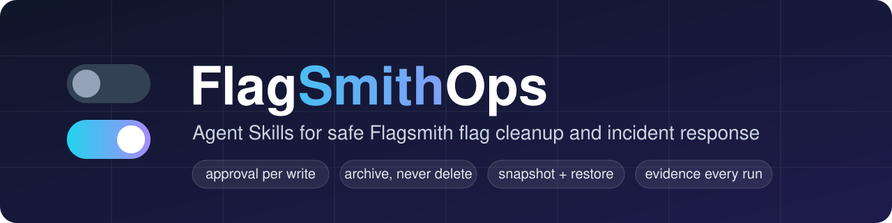

<p align="center">
  
</p>

<p align="center">
  <a href="https://agentskills.io"></a>
  <a href="https://docs.flagsmith.com/integrating-with-flagsmith/CLI"></a>
  
  <a href="docs/reports/VALIDATION-REPORT.md"></a>
</p>

# FlagSmithOps

Two [Agent Skills](https://agentskills.io) that take a coding agent through a whole [Flagsmith](https://www.flagsmith.com) job with the Flagsmith CLI. They work with any agent that supports skills: Claude Code, Codex, Cursor, GitHub Copilot, Gemini CLI, Kiro, Windsurf, OpenCode and more.

| Skill | What it does |
|---|---|
| [`flag-cleanup`](skills/flag-cleanup/SKILL.md) | Finds obsolete flags, removes their code in a pull request, and archives the flags after the PR merges. |
| [`flag-incident-response`](skills/flag-incident-response/SKILL.md) | Traces a broken feature to its flag, disables it in one environment after you approve, checks the effect for specific users, and restores it on request. |

Both skills follow one safety contract:

- **Every Flagsmith write needs your approval** for that exact action.
- **Unknown is never safe.** Missing state, tags, overrides or environments stop the skill instead of letting it guess.
- **Archive, never delete.** Original state is captured first, and restores come from that snapshot.
- **Evidence for every run**, completed or refused. Reports never contain credentials.

## Install

### 1. Prerequisites

- [Flagsmith CLI](https://docs.flagsmith.com/integrating-with-flagsmith/CLI) v2 or newer, logged in (tested with v2.0.0).
- Flagsmith Cloud, or a self-hosted Flagsmith **server** 2.263.0 or newer. The CLI reads from any Flagsmith instance, but its flag-changing commands need server 2.263.0 or newer. Writes were tested on Flagsmith Cloud.
- Python 3 (standard library only), `git`, and the [`gh` CLI](https://cli.github.com) for `flag-cleanup`.
- Node.js 22.20 or newer, if you install with `npx`.

```bash
brew install Flagsmith/tap/flagsmith          # macOS / Linux, or: curl -fsSL https://get.flagsmith.com | sh
flagsmith login                               # or set FLAGSMITH_API_KEY in CI
flagsmith auth status                         # check
```
On Windows (PowerShell): `irm https://raw.githubusercontent.com/Flagsmith/flagsmith-cli/main/install.ps1 | iex`

### 2. Add the skills to your agent

The [`skills` CLI](https://github.com/vercel-labs/skills) copies the skill folders into your agent's skills directory. Run it from your project. Add `-g` to install for all projects, and leave out `-a` to pick agents interactively.

```bash
npx skills add rushibhosalepro/FlagSmithOps
```

<details>
<summary><strong>Claude Code</strong></summary>

```bash
npx skills add rushibhosalepro/FlagSmithOps -a claude-code
```
Installs to `.claude/skills/` (or `~/.claude/skills/` with `-g`).
</details>

<details>
<summary><strong>Codex</strong></summary>

```bash
npx skills add rushibhosalepro/FlagSmithOps -a codex
```
Installs to `.agents/skills/` (or `~/.agents/skills/` with `-g`).
</details>

<details>
<summary><strong>Cursor</strong></summary>

```bash
npx skills add rushibhosalepro/FlagSmithOps -a cursor
```
Installs to `.agents/skills/` (or `~/.cursor/skills/` with `-g`).
</details>

<details>
<summary><strong>GitHub Copilot</strong></summary>

```bash
npx skills add rushibhosalepro/FlagSmithOps -a github-copilot
```
Installs to `.agents/skills/` (or `~/.copilot/skills/` with `-g`).
</details>

<details>
<summary><strong>Gemini CLI</strong></summary>

```bash
npx skills add rushibhosalepro/FlagSmithOps -a gemini-cli
```
Installs to `.agents/skills/` (or `~/.gemini/skills/` with `-g`).
</details>

<details>
<summary><strong>Kiro</strong> (IDE and CLI)</summary>

```bash
npx skills add rushibhosalepro/FlagSmithOps -a kiro-cli
```
Installs to `.kiro/skills/` (or `~/.kiro/skills/` with `-g`), which Kiro IDE and Kiro CLI both read. In Kiro IDE you can also use **Agent Steering & Skills > + > Import a skill**.
</details>

<details>
<summary><strong>Windsurf, OpenCode and other agents</strong></summary>

```bash
npx skills add rushibhosalepro/FlagSmithOps -a windsurf     # .windsurf/skills/
npx skills add rushibhosalepro/FlagSmithOps -a opencode     # .agents/skills/
```
See the [supported agents list](https://github.com/vercel-labs/skills/blob/main/docs/agents.md) for every agent name and folder.
</details>

<details>
<summary><strong>Manual install</strong> (no Node.js)</summary>

Each skill folder is self-contained. Clone this repository and copy both folders into your agent's skills directory, for example `.claude/skills/`, `.agents/skills/` or `.kiro/skills/`:

```bash
git clone https://github.com/rushibhosalepro/FlagSmithOps.git
mkdir -p .claude/skills && cp -r FlagSmithOps/skills/flag-cleanup FlagSmithOps/skills/flag-incident-response .claude/skills/
```
Windows (PowerShell): `Copy-Item -Recurse FlagSmithOps\skills\flag-cleanup, FlagSmithOps\skills\flag-incident-response .claude\skills\`
</details>

Update with `npx skills update`, and remove with `npx skills remove`. The `skills` CLI sends anonymous usage data. Set `DISABLE_TELEMETRY=1` to turn that off.

### 3. Check it loaded

Start a new agent session. Most agents list skills when you type `/`. Look for `flag-cleanup` and `flag-incident-response`.

## Why these skills exist

Feature flags make releases safer. They also create two jobs that teams put off or rush: removing flags once they are done, and switching one off fast when it breaks production. Coding agents can do both, but without guidance they guess. These skills fix three failure modes.

### #1: Flags never get removed

> "Feature flags are meant to be temporary. When a rollout is complete or an experiment has ended, the flag should be removed from your code and from Flagsmith."
>
> [Flagsmith docs, Stale Flag Detection](https://docs.flagsmith.com/managing-flags/stale-flags)

**The problem.** Everyone plans to remove flags, and few do. A 2021 study found that 77% of developers intend to remove toggles once a system stabilises. When the codebases were audited, 75% of toggle components were still present up to 49 weeks after they were introduced ([quoted by GrowthBook](https://www.growthbook.io/blog/engineering-guide-feature-flag-technical-debt)). Cleanup is slow because it is several jobs at once: find every reference, decide which code path to keep, open a PR, and only archive the flag once the change has shipped.

**The fix** is [`flag-cleanup`](skills/flag-cleanup/SKILL.md). It does the whole job, from discovery to the post-merge archive, and it refuses the flags it should not touch: permanent-tagged flags, flags with references it cannot account for, and flags whose state in any environment is unknown. It also blocks archiving before the PR merges.

### #2: An incident needs the flag off now, safely

> "...in 2012, a poorly managed feature flag cost the financial firm Knight Capital $440M in a span of about 45 minutes."
>
> [OpenFeature blog](https://openfeature.dev/blog/feature-flags-with-great-power-comes-great-responsibility/)

**The problem.** When a flagged feature breaks production, the kill switch is right there, and that is the risk. Under pressure it is easy to switch off the wrong flag, change the wrong environment, or forget what the state was before. A user override can also keep the broken feature on for some people after the "fix".

**The fix** is [`flag-incident-response`](skills/flag-incident-response/SKILL.md). It finds the flag with evidence and asks you to confirm it. It snapshots every environment, then disables one flag in one environment, only after your yes and only through a pre-write gate. Afterwards it checks real identities and reports PARTIAL if an override still serves the feature. Restore is one command, taken from the snapshot.

### #3: Agents guess when they lack context

**The problem.** In our baseline run, a general coding agent was given the same cleanup task without these skills. It said that archiving a flag hides it from SDKs, which we verified is false: archived flags keep evaluating. It never read the flags' tags. It also printed the Production environment key in its message to the user. Nothing it did was malicious. It simply filled the gaps with guesses (see [`VALIDATION-REPORT.md`](docs/reports/VALIDATION-REPORT.md), section 5).

**The fix** is to give the agent facts and gates instead of freedom. Both skills read the real CLI output, treat missing information as a reason to stop and ask, keep keys out of their output, and write an evidence report for every run. In the final round's 9 fresh agent sessions, including ones that asked the agent to delete a flag, skip the gate, or archive before the merge, there were no writes without approval, no deletes and no direct CLI calls (see [the transcripts](docs/reports/kiro-final/TRANSCRIPTS.md)).

## Use

Say what you want in plain language. The skill asks for what it needs: the project, the environments, which one is production, and which repositories to search.

```text
Clean up the obsolete feature flags in this repo.
```
```text
Checkout is failing in production. I think it is behind a feature flag. Find it and turn it off.
```

<details>
<summary><strong>What happens in <code>flag-cleanup</code></strong></summary>

1. Reads every flag, its tags and its state in **every** environment, then searches the code for references.
2. Shows a verdict table: **PROCEED**, **APPROVAL REQUIRED** or **REFUSE** for each flag, with reasons. Permanent-tagged flags are refused.
3. Asks which code path to keep, then asks before changing code and opening the PR.
4. After the PR merges, re-checks live state and asks before archiving each flag. Archiving before the merge is blocked, with no override.
</details>

<details>
<summary><strong>What happens in <code>flag-incident-response</code></strong></summary>

1. Ranks candidate flags with evidence, and asks you to confirm one.
2. Snapshots the flag in every environment, then runs a pre-write gate.
3. Shows the exact change and the restore command, and waits for your yes.
4. Disables only through the gate, then checks what the flag resolves to for the users you name. It never claims the incident is over without your confirmation.
5. Restores from the snapshot when you ask, and verifies it matches.
</details>

## Try it on a live demo

| Example | What it shows |
|---|---|
| [`examples/demo-shop`](examples/demo-shop/) | The app the skills were validated on against live Flagsmith. Setup commands, the prompt for each drill, the expected result, and a link to the recorded run. |
| [`examples/notes-service`](examples/notes-service/) | Both skills in sequence on one flag (incident, fix, cleanup), plus the blind spots the skills must report: an SDK wrapper and a flag read only in Go. |

What was verified, what is partial and what is not tested is in [`docs/reports/VALIDATION-REPORT.md`](docs/reports/VALIDATION-REPORT.md).

## Limits

- Code search covers JavaScript, TypeScript and Python. Other languages are reported as not searched.
- The skills cannot see other repositories or services. Before archiving, `flag-cleanup` asks you to confirm nothing else uses the flag.
- Restore covers the environment default (enabled state and a plain value). Variants, weights and overrides are reported, never changed.
- The bundled CLI wrapper is a guard rail for an agent following the skill, **not a security boundary**. Limit what the agent can do with its Flagsmith credentials. See [`docs/wrapper-limits.md`](docs/wrapper-limits.md).
- A successful CLI command does not prove an incident is over.
- Change requests and scheduled changes (paid Flagsmith plans) are not supported. Token savings have not been measured.

<details>
<summary><strong>Develop</strong></summary>

```bash
python -m unittest discover -s tests/cleanup
python -m unittest discover -s tests/incident
python shared/sync.py                                  # copy shared/scripts into each skill
python shared/sync.py --check                          # fail if a copy is out of date
python shared/validate_skill.py skills/flag-cleanup    # check the Agent Skills format
```
Edit scripts in `shared/scripts/`, then run `sync.py`. On macOS and Linux, use `python3` if `python` is not available.

```text
skills/        the two skills (SKILL.md, scripts/, references/)
shared/        shared scripts, evidence template, safety contract, sync and validation
tests/         unit tests and fixtures
examples/      demo apps and walkthroughs for the live drills
docs/          CLI findings, wrapper limits, recorded live runs (docs/reports/)
benchmarks/    benchmark method and results
```
</details>
